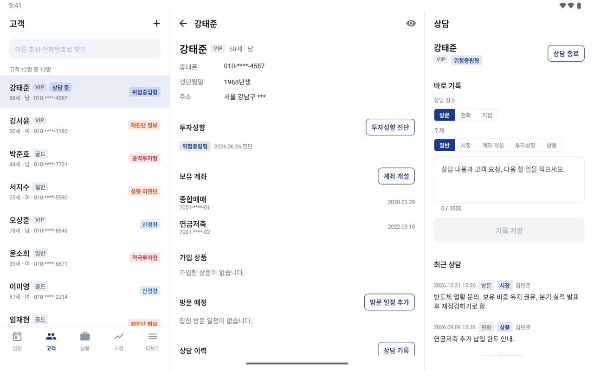
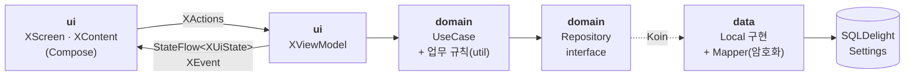
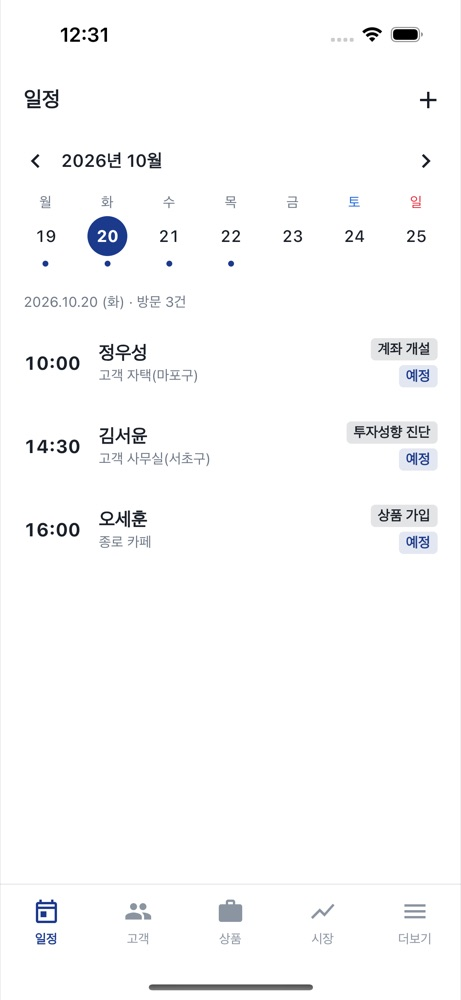
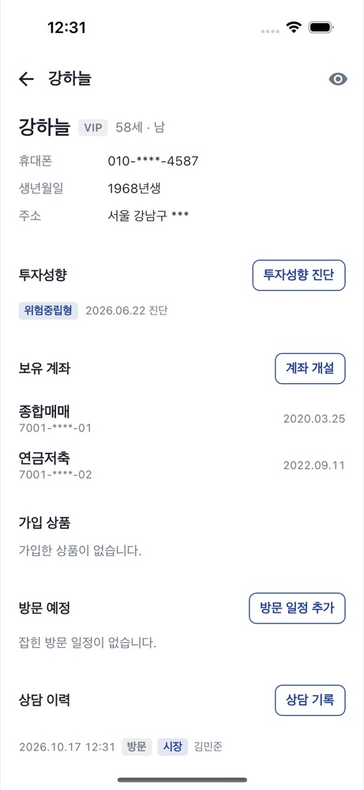
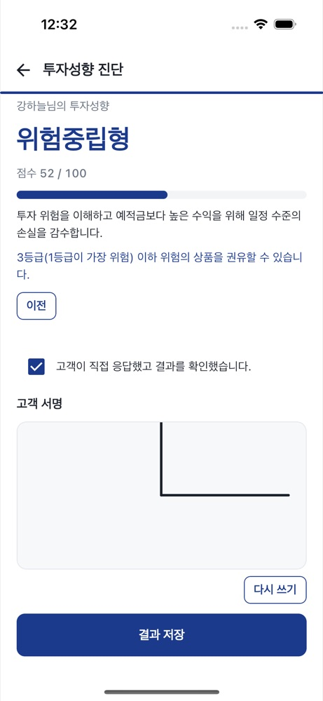
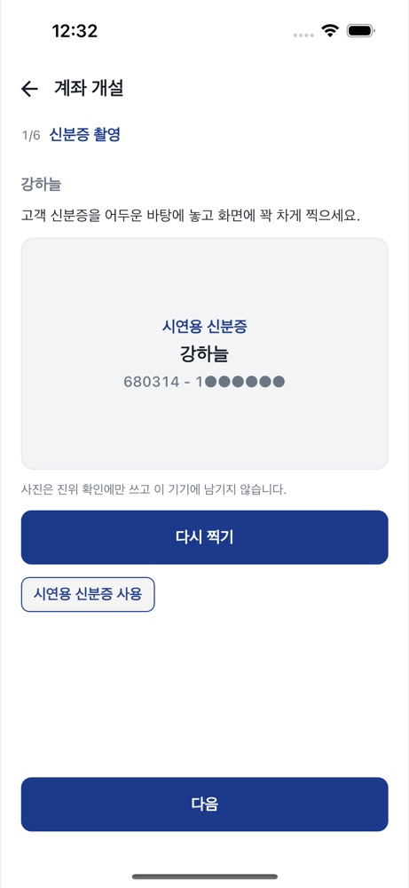
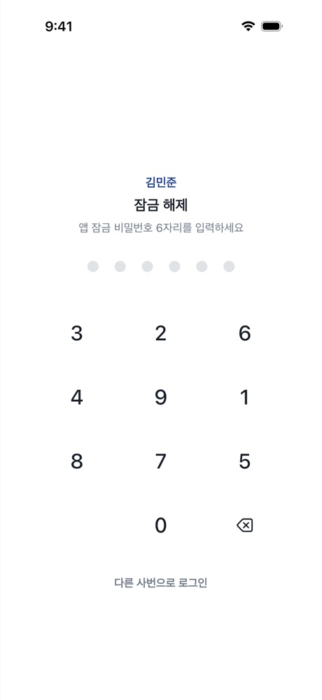
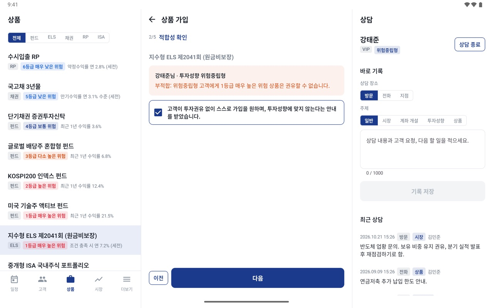
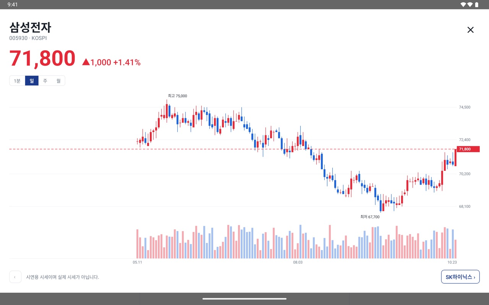

# ODS — 증권사 아웃도어 세일즈 앱


증권사 영업 직원이 태블릿을 들고 **지점 밖에서 고객을 만나** 상담 · 투자성향 진단 · 상품 가입 · 계좌 개설을 현장에서 마치는 앱입니다.
Kotlin Multiplatform 과 Compose Multiplatform 으로 Android · iOS 를 한 코드로 만들었고, 창 폭에 따라 폰 · 태블릿 2칸 · 태블릿 3칸 레이아웃으로 바뀝니다.

| 항목 | 내용 |
|---|---|
| 플랫폼 | Android · iOS — 공통 코드(UI 포함)와 플랫폼별 `actual`(생체 인증 · 카메라 · 보안 저장소) |
| 아키텍처 | Clean Architecture(ui · domain · data) + MVI |
| 데이터 | 서버 없이 기기 안 시연용 데이터로만 도는 **로컬 전용** 앱. 네트워크를 쓰지 않음 |
| 보안 | 직원별 앱 잠금, 5회 오류 시 업무 데이터 삭제, 개인정보 칸 암호화(Keystore · Keychain) |
| 검증 | 단위 · ViewModel 시나리오 테스트(JVM 122 · iOS 118) + Maestro 실화면 흐름 7개 × Android · iOS, 명령 하나로 실행 |

<p align="center">
  
  <br><sub>태블릿 가로 3칸 — 고객 목록 · 상세 · 상담 기록을 한 화면에서. 다른 화면은 맨 아래 <a href="#앱-소개">앱 소개</a>에 있습니다.</sub>
</p>

---

## 개발 환경

| 구분 | 버전 |
|---|---|
| Kotlin · Compose Multiplatform | 2.3.20 · 1.11.1 (Material3) |
| Gradle · Android Gradle Plugin | 9.3.1 · 8.11.2 |
| JDK | 17 (JVM 타깃 11) |
| Android | compileSdk · targetSdk 36, minSdk 24 (Android 7.0) |
| iOS | 배포 타깃 16.0, Xcode 26 |
| 검증 도구 | kotlin.test · kotlinx-coroutines-test · Maestro 2.11 |

### 실행

```bash
./gradlew :composeApp:installDebug          # Android (에뮬레이터 또는 기기)
open iosApp/iosApp.xcodeproj                # iOS — Xcode 에서 시뮬레이터를 고르고 실행
```

- `local.properties` 에 Android SDK 경로(`sdk.dir`)가 필요합니다.
- 시연 계정 `test1` ~ `test3` / `1234`. 처음 로그인하면 앱 잠금 비밀번호 6자리를 정합니다.

---

## 아키텍처



- **MVI 변형** — 화면은 `XActions` 만 보내고 ViewModel 의 `StateFlow<XUiState>` 만 그립니다. 한 번만 처리할 일(이동 · 알림)은 `XEvent` 를 `Channel` 로 보냅니다.
- **의존 방향** — 화면은 ViewModel 만, ViewModel 은 유스케이스만 봅니다. 여러 저장소를 잇는 업무(가입 · 계좌 개설 · 진단 저장)는 유스케이스가 하고,
  화면이 이미 막은 조건(적합성 · 금액 · 계좌 · 서명 · 약관)도 저장 직전에 **한 번 더 확인**합니다.
- **저장소는 인터페이스 뒤에** — 유스케이스는 저장소 인터페이스만 보고, 구현은 `di/Modules.kt` 한 곳에서 묶습니다. 테스트는 같은 구현을 인메모리 DB 위에 세웁니다.

### 프로젝트 구조

```
composeApp/src/
  commonMain/kotlin/com/eunilsung/ods/
    data/      local(저장소 구현 · 시연용 데이터 · 암호화 · 데이터 삭제) · mapper
    domain/    model · repository(interface) · usecase · util(업무 규칙)
    ui/        main(폰 · 태블릿 레이아웃) · login · schedule · customer · risk · product · account
               watchlist · quote · consult · applock · more · uikit(공용 부품) · theme
    di/        Modules.kt (Koin)
    Config.kt  DB 이름 · 화면 폭 기준 · 보안 설정
  commonMain/sqldelight/          AppDatabase.sq
  commonMain/composeResources/    values(영문) · values-ko(한글) · drawable
  androidMain/   actual · BiometricPrompt · 카메라(FileProvider) · Keystore 암호 · 앱 전환기 가리기
  iosMain/       actual · LAContext · 카메라(UIImagePickerController) · Keychain 암호 · 앱 전환기 가리기
  commonTest/    업무 규칙 · 저장소 · ViewModel 시나리오 (androidUnitTest · iosTest 에서 함께 돈다)
iosApp/          Xcode 프로젝트
.maestro/        실화면 흐름(Android · iOS 공용) · run.sh
```

### 적응형 레이아웃

기기 종류가 아니라 **지금 창의 폭**으로 가릅니다(`Config.Layout`). 상세 화면은 모두 하나의 오른쪽 스택(`LocalRightNavigator`)에 쌓아,
창 크기가 바뀌어도 보던 화면이 그대로 이어집니다.

| 창 폭 | 레이아웃 |
|---|---|
| 600dp 미만 | 폰 — 탭 목록 위로 상세가 오른쪽에서 밀려 들어옴 |
| 600dp 이상 | 태블릿 2칸 — 목록 · 상세 |
| 1000dp 이상 | 태블릿 3칸 — 목록 · 상세 · 상담 칸(상담 중인 고객 요약 · 바로 기록 · 최근 상담) |

---

## 기술 스택

| 영역 | 사용 기술 | 쓰임 |
|---|---|---|
| UI | Compose Multiplatform, Material3 | 공통 UI. 봉 차트 · 서명 칸은 `Canvas` 로 직접 그림 |
| 네비게이션 | Voyager 1.0.1 | 탭 + 오른쪽 스택 하나를 폰 · 태블릿이 공유 |
| DI | Koin 4.2.1 | 저장소 · 유스케이스 · ViewModel |
| 기기 DB | SQLDelight 2.3.2 | 고객 · 상담 · 일정 · 계좌 · 가입 · 서명 지문, `Flow` 로 화면에 반영 |
| 설정 | multiplatform-settings 1.3.0 | 화면 설정 · 앱 잠금 · 로그인 잠금 |
| 암호 | Android Keystore · iOS Keychain/CommonCrypto · krypto 4.0.10 | 개인정보 칸 암호화, 비밀번호 salt + SHA-256 |
| 비동기 · 시간 | kotlinx-coroutines 1.10.2 · kotlinx-datetime 0.6.1 | 서울 시간 기준 일정 · 나이 · 유효기간 계산 |
| 플랫폼 기능 | BiometricPrompt · LAContext, FileProvider · UIImagePickerController | 생체 인증, 신분증 촬영 |

---

## 설계 포인트

### 업무 규칙은 순수 함수로

규칙은 `domain/util` 에 플랫폼과 무관한 순수 함수로 두고 단위 테스트로 지킵니다. 화면 · 유스케이스가 같은 함수를 씁니다.

| 규칙 | 내용 | 코드 |
|---|---|---|
| 투자성향 | 7문항 → 0~100점 → 5단계, 유효기간 1년, 65세 이상 고령투자자 안내 | `RiskAssessmentPolicy` |
| 적합성 | 성향 없음 · 만료 → 진단부터, 성향보다 위험한 상품 → 고객 자발 확인 필요 | `suitabilityFor` |
| 숙려기간 | 고령투자자 × (고난도 또는 1 · 2등급 상품) → 2일 | `SubscriptionPolicy` |
| 계좌 개설 | 신분증 대조, ISA 만 19세 · 1인 1계좌, 연금저축 중복 금지, 약한 비밀번호 금지 | `AccountOpeningPolicy` |
| 서명 | 점 10개 이상, 칸의 15% 이상 퍼져야 받음 | `SignaturePolicy` |
| 앱 잠금 | 6자리, 5분 무조작 · 백그라운드 1분 초과 시 잠금, 5회 오류 시 데이터 삭제 | `AppLockPolicy` |

### 들고 다니는 단말을 위한 보안

- **앱 잠금** — 직원별 6자리 비밀번호(+생체 인증). 잠겨도 보던 업무 화면은 버리지 않습니다. 5번 틀리면 업무 데이터 · 잠금 비밀번호를 지우고 로그아웃합니다.
- **개인정보 칸 암호화** — 고객 이름 · 생년월일 · 전화번호 · 주소, 상담 내용, 방문 장소 · 메모, 계좌번호를 칸 단위로 잠가 저장합니다.
  잠금 비밀번호의 salt · 해시와 기억한 사번도 잠가, 설정 파일만 빼내서는 6자리를 대입해 볼 수 없습니다.

  | | Android | iOS |
  |---|---|---|
  | 키 | Keystore 키(꺼낼 수 없음)로 감싼 데이터 키 | Keychain(`WhenUnlockedThisDeviceOnly`) |
  | 암호 | AES-256-GCM | AES-256-CBC + HMAC-SHA256 |
  | 백업 | `allowBackup=false` · `dataExtractionRules` | DB 폴더를 백업에서 제외 |

  앱 시작 때 키와 DB 의 짝을 확인해 맞지 않으면 풀 수 없는 데이터를 지우고, 데이터를 지울 때는 키도 버려 DB 파일에 남은 조각까지 풀 수 없게 합니다.
- **저장하지 않는 것** — 신분증 사진(Android 는 임시 파일을 읽자마자 삭제, iOS 는 메모리로만), 주민번호 뒷자리, 계좌 비밀번호, 서명 그림(지문 해시만), 로그인 비밀번호.
- **화면 보호** — 앱 전환기에서 화면 가리기(Android · iOS), 배포용 Android 빌드의 화면 캡처 차단. 화면의 전화번호 · 생년월일 · 주소 · 계좌번호는 기본으로 가립니다.

### 로컬 모드와 다국어

- 설치만 하면 시연용 고객 · 일정 · 상품 · 시세로 전 과정을 따라갈 수 있습니다. 업무 데이터를 지운 뒤 다시 로그인하면 처음 상태로 돌아옵니다.
- 한글은 하드코딩하지 않고 `composeResources/values`(영문) · `values-ko`(한글)로 나눴습니다. 상담 이력에 자동으로 남기는 문구도 화면이 만들어 넘깁니다.

---

## 테스트 · 검증

```bash
./gradlew :composeApp:verifyAll --continue   # 전체 — 약 18분, 꺼진 기기도 켜서 돈다
./gradlew :composeApp:testDebugUnitTest      # 빠르게 — JVM 테스트만
```

Android Studio 에서는 실행 구성 `검증 - 전체 (실화면 포함)` · `검증 - 빠르게 (JVM)` 을 고릅니다.

| 층 | 내용 |
|---|---|
| 단위 테스트 | 업무 규칙, 저장소(인메모리 DB), 암호화(대역 키 · 플랫폼 암호 코드) |
| ViewModel 시나리오 | 진짜 로컬 저장소 위에 화면의 ViewModel 을 세워 상태 · 이벤트를 확인. Android(JVM) · iOS 시뮬레이터 양쪽에서 돈다 |
| 실화면 흐름 (Maestro) | 로그인 · 시장 / 앱 잠금 · 데이터 삭제 / 고객 · 상담 / 방문 일정 / 투자성향 · 서명 / 상품 가입 / 계좌 개설 — Android 에뮬레이터 · iOS 시뮬레이터 |

- 검증 기기는 `local.properties` 의 `e2e.androidAvd` · `e2e.iosDevice` 로 정합니다. 결과는 `composeApp/build/test-results/`, `build/maestro/<android|ios>/report.xml`.
- 자동으로 확인하지 못하는 것: 실제 카메라 촬영, 생체 인증, 배포 빌드의 캡처 차단, 백업 복원처럼 키를 실제로 잃는 경우.

### 아직 없는 것

신분증 OCR · 사진 속 주민번호 가리기, 숙려기간 중 철회, 가입 내역 상세 · 해지, 전용 글꼴.

---

## 앱 소개

**밖에서 만나는 고객 상담, 태블릿 하나로 끝까지.**
방문 일정부터 상담 기록, 투자성향 진단, 상품 가입, 계좌 개설까지 — 지점에 돌아가지 않고 고객 앞에서 마칩니다.

- **오늘의 방문** — 주 · 월 달력(밀어서 넘기기)과 고른 날의 방문, 방문을 마치면 바로 상담 기록
- **고객 상담** — 이름 · 초성 · 전화번호로 찾고, 상담 이력과 보유 계좌 · 가입 상품을 한 화면에
- **투자성향 진단 · 전자서명** — 7문항 진단 후 고객 확인과 서명까지
- **적합성 원칙에 맞춘 가입** — 성향보다 위험한 상품은 고객 확인 없이 진행하지 않음
- **현장 계좌 개설** — 신분증 촬영 · 대조, 고객이 직접 입력하는 계좌 비밀번호
- **고객에게 보여 주기** — 종목 · 시세 · 차트만 화면 가득 크게

<p align="center">
  
  
  
  
  
</p>
<p align="center">
  
  
  
</p>

<p align="center"><sub>화면의 고객 · 계좌 · 시세는 모두 시연용 예시 값입니다. 디자인 방향은 <a href="docs/design-proposal.html">docs/design-proposal.html</a> 에 있습니다.</sub></p>
