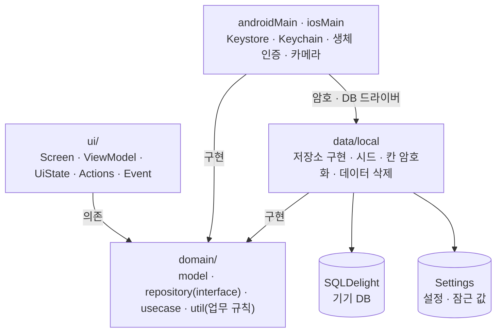
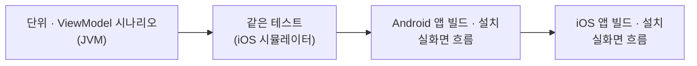

# Securities_ODS_Mobile

**Compose Multiplatform 으로 만든 Android · iOS 증권사 아웃도어 세일즈(ODS) 앱** — 서버 없이 기기 안 시연용 데이터로 상담부터 계좌 개설까지 동작합니다.


증권사 영업 직원이 태블릿을 들고 **지점 밖에서 고객을 만나** 상담 · 투자성향 진단 · 상품 가입 · 계좌 개설을 현장에서 마치는 앱입니다.

- **로컬 전용** — 백엔드나 계정 없이 `installDebug` 한 번이면 실행됩니다. 시연용 고객 · 일정 · 상품 · 시세가 기기 DB 를 오가며 동작하고, 앱에는 네트워크 권한이 없습니다.
- **적응형 레이아웃** — 창 폭에 따라 폰 · 태블릿 2칸 · 태블릿 3칸(목록 · 상세 · 상담)으로 바뀝니다.
- **들고 다니는 단말의 보안** — 직원별 앱 잠금, 5번 틀리면 업무 데이터 삭제, 개인정보 칸 암호화(Keystore · Keychain).

<p align="center">
  
  
  
</p>
<p align="center"><sub>태블릿 가로는 고객 목록 · 상세 · 상담 기록을 한 화면에, 폰은 한 화면씩. 화면의 고객 · 계좌 · 시세는 모두 지어낸 시연용 값입니다.</sub></p>

---

## 주요 기능

### 방문 일정
- **주 · 월 달력** — 좌우로 밀면 앞뒤 주 · 달이 손가락을 따라 넘어오고, 일정 탭은 마지막에 쓴 보기를 기억합니다
- 날짜 아래 방문 점, 고른 날의 방문 목록(시각순, 취소는 흐리게)
- **방문 상세** — 시각 · 장소 · 목적 · 메모. 방문을 마치면 목적에 맞는 주제로 **상담 기록이 바로 열립니다**
- **방문 일정 추가** — 고객 찾기, 지난 날 · 지난 시각은 고를 수 없음, 08:00~20:30 30분 간격

### 고객 · 상담
- **고객 찾기** — 이름 일부 · 한글 초성(`ㄱㅌㅈ`) · 전화번호 숫자 일부
- **고객 상세** — 기본 정보 · 투자성향(진단일 · 만료) · 보유 계좌 · 가입 상품 · 방문 예정 · 상담 이력을 한 화면에. 눈 버튼으로 개인정보 보기 / 가리기
- **상담 기록** — 장소(방문 · 전화 · 지점) · 주제(일반 · 시장 · 계좌 개설 · 투자성향 · 상품)
- **상담 칸**(태블릿 가로) — 상담 중인 고객 요약 · 바로 기록 · 최근 상담. 가운데에서 시세를 보여 주거나 상품을 설명하는 동안에도 남습니다
- **신규 고객 등록** — 현장에서 처음 만난 고객을 등록하고 바로 상담을 시작

### 투자성향 진단
- **7문항** → 0~100점 → **5단계 성향**(안정형 ~ 공격투자형)과 권유할 수 있는 위험등급
- **65세 이상 고령투자자** 안내, 유효기간 1년(지나면 '재진단 필요'로 상품 권유를 막음)
- 고객 확인 + **전자서명** 뒤 저장 — 성향 갱신 · 서명 지문 · 상담 이력이 함께 남습니다

### 상품 가입
- 유형 칩(펀드 · ELS · 채권 · RP · ISA)과 **6단계 위험등급**, 상담 중인 고객에게 맞는지 상세에서 바로 보입니다
- **5단계 가입** — 고객 선택 → 적합성 확인 → 핵심 설명(항목마다 확인) → 계좌 · 금액 → 서명
- **적합성 원칙** — 성향이 없거나 만료면 진단부터, 성향보다 위험한 상품은 **고객 자발 확인** 없이는 진행하지 않습니다
- 고령투자자 × (고난도 또는 1 · 2등급) → **숙려기간** 안내

### 계좌 개설
- **6단계** — 신분증 촬영 → 본인 확인 → 계좌 종류 → 약관 동의 → 계좌 비밀번호 → 서명
- 신분증의 이름 · 주민번호 앞자리 · 뒷자리 첫 숫자를 고객 정보와 대조한 뒤 진위 확인(로컬에서는 흉내). **시연용 신분증**으로도 진행할 수 있습니다
- 계좌 종류 제한 — ISA 는 만 19세 이상 · 1인 1계좌, 연금저축 중복 금지
- **계좌 비밀번호는 고객이 직접** — 열 때마다 숫자가 섞이는 보안 키패드, 같은 · 연속 숫자와 생년월일이 든 비밀번호 금지

### 시장 · 고객에게 보여 주기
- 관심종목 7개, **현재가** · 시가/고가/저가 · 상한/하한가, **봉 차트**(1분 · 일 · 주 · 월, `Canvas` 로 직접 그림), **호가 10단계**
- **실시간처럼 움직이는 시연 시세** — 보고 있는 종목이 한국거래소 호가 단위 · 상하한가 안에서 1~3초마다 움직이고 오름 · 내림 색으로 번쩍입니다
- **고객에게 보여 주기** — 종목 · 시세 · 차트만 화면 가득, 이전 · 다음으로 관심종목을 넘깁니다

### 보안
- **로그인** — 같은 사번 5번 실패 시 5분 잠금. 없는 사번도 같은 응답이라 어느 사번이 있는지 드러나지 않습니다
- **앱 잠금** — 직원별 6자리 + **생체 인증**, 5분 무조작 · 백그라운드 1분 초과 시 잠금. 잠겨도 보던 업무 화면은 그대로입니다
- **5번 틀리면 업무 데이터 삭제** — 기기의 업무 데이터와 모든 잠금 비밀번호를 지우고 키도 버린 뒤 로그아웃
- **개인정보 가리기**(기본 켬) — 전화 `010-****-4587`, 생년월일은 연도만, 주소는 시 · 구까지, 계좌번호 `7001-****-01`
- **앱 전환기 가림**(Android · iOS), 배포용 Android 빌드의 화면 캡처 차단

### 그 외
- **태블릿 · 폴더블 2칸 · 3칸**, Android 폰은 세로 고정 · 태블릿은 회전
- **한국어 / 영어** (문자열 387개, 양쪽 키 완전 일치), 다크 모드
- 설정 — 목록 밀도 · 개인정보 가리기 · 잠금 비밀번호 변경 · 생체 인증 · 지금 잠그기 · 앱 정보

<p align="center">
  
  
  
  
</p>
<p align="center">
  
  
  
</p>
<p align="center">
  
  
  
</p>
<p align="center">
  
  
</p>
<p align="center"><sub>폰은 iOS 시뮬레이터(iPhone 17 Pro), 태블릿은 Android 에뮬레이터(2560×1600). 디자인 방향은 <a href="docs/design-proposal.html">docs/design-proposal.html</a> 에 있습니다.</sub></p>

**아직 없는 것** — 신분증 OCR · 사진 속 주민번호 가리기, 숙려기간 중 철회, 가입 내역 상세 · 해지, 전용 글꼴.

---

## 기술 스택

| 분류 | 사용 기술 |
|---|---|
| 언어 · UI | Kotlin 2.3.20, Compose Multiplatform 1.11.1, Material3 1.11.0-alpha07 |
| 아키텍처 | Clean Architecture (ui / domain / data), MVI |
| DI | Koin 4.2.1 |
| 네비게이션 | Voyager 1.0.1 |
| 기기 DB | SQLDelight 2.3.2 (테이블 8개) |
| 설정 저장 | multiplatform-settings 1.3.0 |
| 암호 | Android Keystore · iOS Keychain · CommonCrypto, krypto 4.0.10(SHA-256) |
| 시간 | kotlinx-datetime 0.6.1 — 서울 시간 기준 일정 · 나이 · 유효기간 |
| 플랫폼 기능 | AndroidX Biometric 1.1.0 · LAContext(생체 인증), FileProvider · UIImagePickerController(신분증 촬영) |
| 검증 | kotlin.test, kotlinx-coroutines-test, Maestro 2.11 |

**타깃** — Android `minSdk 24` / `targetSdk 36`, iOS 16.0+ `iosArm64` · `iosSimulatorArm64` · **빌드** — Gradle 9.3.1, AGP 8.11.2, JDK 17

---

## 아키텍처



의존성은 **안쪽으로만** 흐릅니다. 화면은 ViewModel 만, ViewModel 은 유스케이스만 보고, `domain` 은 `ui` · `data` 와 Compose 타입을 모릅니다.
구현은 Koin 으로 묶습니다 — 공통은 `di/Modules.kt`, 플랫폼(암호 · 생체 인증 · DB 드라이버 · 앱 버전)은 `platformModule` 입니다.

```
composeApp/src/
├── commonMain/          225 files — 화면 · 도메인 · 데이터 전부 (Kotlin 208)
│   ├── kotlin/com/eunilsung/ods/
│   │   ├── ui/          132 files — 화면 14갈래 (main · login · applock · schedule · customer · consult · risk · product · account · watchlist · quote · stockdetail · setting · more) · uikit(공용 부품) · theme
│   │   ├── domain/       42 files — model · repository(interface 14) · usecase(59 + 화면별 묶음 17) · util(업무 규칙)
│   │   ├── data/         27 files — local(저장소 구현 11 · 시세 흉내 · seed 시연용 데이터 · 칸 암호화 · 키 확인 · 데이터 삭제) · mapper
│   │   ├── di/                    Koin 모듈 (ViewModel 19)
│   │   └── Config.kt              DB 이름 · 화면 폭 기준 · 보안 설정
│   ├── sqldelight/                AppDatabase.sq (테이블 8 · 쿼리 29)
│   └── composeResources/          values(영문) · values-ko(한글) · drawable
├── androidMain/          26 files — actual · BiometricPrompt · 카메라(FileProvider) · Keystore 암호 · 백업 제외 · 앱 전환기 가리기
├── iosMain/              13 files — actual · LAContext · 카메라(UIImagePickerController) · Keychain 암호 · 백업 제외 · 앱 전환기 가리기
├── commonTest/           25 files — 업무 규칙 · 저장소(인메모리 DB) · 칸 암호화 · ViewModel 시나리오 (Android · iOS 양쪽에서 돈다)
├── androidUnitTest/       3 files — Keystore 봉투 암호 · 앱 전환기 가리기
└── iosTest/               2 files — iOS 암호(CommonCrypto)
iosApp/                   Xcode 프로젝트 (Swift 진입점 · Info.plist · Config.xcconfig)
.maestro/                 실화면 흐름 7개 · 공용 단계 5개 · run.sh — Android · iOS 에 같은 파일을 돌린다
.run/                     Android Studio 실행 구성 2개
docs/                     디자인 제안서 · 스크린샷
```

**화면 패턴** — 19개 ViewModel 이 `StateFlow<XUiState>` 를 내고, 화면은 `XActions` 로 이벤트를 한 방향으로 보냅니다. 이동 · 알림처럼 한 번만 처리할 일은 `XEvent`(`Channel`)로 받습니다.

**적응형 레이아웃** — 기기 종류가 아니라 **지금 창의 폭**으로 가릅니다(`Config.Layout`).

| 창 폭 | 레이아웃 |
|---|---|
| 600dp 미만 | 폰 — 탭 목록 위로 상세가 오른쪽에서 밀려 들어옴, 왼쪽에서 밀어 닫기 |
| 600dp 이상 | 태블릿 2칸 — 목록 · 상세 |
| 1000dp 이상 | 태블릿 3칸 — 목록 · 상세 · 상담 칸 |

---

## 로컬 데이터 설계

서버가 없어도 "진짜처럼" 동작하게 만든 부분입니다.

- **시연용 시드** — 직원 3명, 고객 12명 · 계좌 14개 · 상담 10건, 방문 7건, 상품 8개, 관심종목 7개. 시각은 "며칠 전 · 며칠 뒤"로 적어
  넣는 순간을 기준으로 계산해, 언제 켜도 투자성향 유효기간 · 오늘의 방문이 그럴듯하게 보입니다. 표가 비어 있을 때만 넣습니다.
- **실제 CRUD** — 고객 등록 · 상담 · 방문 · 투자성향 · 가입 · 계좌 · 서명 지문이 모두 SQLDelight 를 거치고, 앱을 다시 켜도 남습니다.
- **화면은 기기 DB 의 `Flow` 를 봅니다** — 저장하면 화면이 따로 다시 읽지 않아도 바뀝니다. 시세도 시뮬레이터가 DB 에 쓰고
  관심종목 · 현재가 · 호가 · 봉이 같은 행을 따라옵니다.
- **칸 단위 암호화** — 고객 이름 · 생년월일 · 전화 · 주소, 상담 내용, 방문 장소 · 메모, 계좌번호만 잠급니다. 잠그지 못하면 평문으로 두지 않고 저장을 실패시킵니다.
  잠금 비밀번호의 salt · 해시와 기억한 사번도 잠가, 설정 파일만 빼내서는 6자리를 대입해 볼 수 없습니다.

  | | Android | iOS |
  |---|---|---|
  | 키 | Keystore 키(꺼낼 수 없음)로 감싼 데이터 키 | Keychain(`WhenUnlockedThisDeviceOnly`) |
  | 암호 | AES-256-GCM | AES-256-CBC + HMAC-SHA256 |
  | 백업 | `allowBackup=false` · `dataExtractionRules` | DB 폴더를 백업에서 제외 |

- **키와 DB 의 짝 확인** — DB 를 열 때 확인값을 풀어 보고, 풀리지 않으면(앱 데이터를 다른 기기로 옮김 · 보안 저장소 초기화) 업무 데이터를 지우고 키를 새로 만듭니다.
- **업무 데이터 삭제** — 잠금 비밀번호 5회 오류 때 업무 표를 비우고 키를 버려, DB 파일에 남은 조각까지 풀 수 없게 합니다. 다시 로그인하면 시드로 처음 상태가 됩니다.
- **저장하지 않는 것** — 신분증 사진(메모리에만), 주민번호 뒷자리, 계좌 비밀번호, 서명 그림(지문 해시만), 로그인 비밀번호.
- 시드 · 스키마를 바꿀 땐 `Config.Database.NAME` 을 올려 새 DB 로 시작하고, 예전 DB 파일은 `LEGACY_NAMES` 로 지웁니다.

---

## 업무 규칙

규칙은 `domain/util` 에 플랫폼과 무관한 순수 함수로 두고 단위 테스트로 지킵니다. 화면과 유스케이스가 같은 함수를 쓰고,
**화면이 이미 막은 조건(적합성 · 금액 · 계좌 · 서명 · 약관)도 저장 직전에 유스케이스가 한 번 더 확인**합니다.

| 규칙 | 내용 | 코드 |
|---|---|---|
| 투자성향 | 7문항 → 0~100점 → 5단계, 65세 이상 고령투자자 | `RiskAssessmentPolicy` |
| 성향 유효기간 | 진단 후 1년, 지나면 재진단부터 | `RiskProfilePolicy` |
| 적합성 | 성향 없음 · 만료 → 진단부터, 성향보다 위험한 상품 → 고객 자발 확인 필요 | `suitabilityFor` |
| 숙려기간 | 고령투자자 × (고난도 또는 1 · 2등급 상품) → 2일 | `SubscriptionPolicy` |
| 계좌 개설 | 신분증 대조, ISA 만 19세 · 1인 1계좌, 연금저축 중복 금지, 약한 비밀번호 금지 | `AccountOpeningPolicy` |
| 서명 | 점 10개 이상, 칸의 15% 이상 퍼져야 받음 | `SignaturePolicy` |
| 방문 | 08:00~20:30 30분 간격, 지난 시각 금지 | `VisitPolicy` |
| 로그인 · 앱 잠금 | 로그인 5회 실패 시 5분 잠금 / 6자리, 5분 무조작 · 백그라운드 1분 초과 시 잠금, 5회 오류 시 데이터 삭제 | `LoginPolicy` · `AppLockPolicy` |

---

## 테스트

**단위 · ViewModel 시나리오 126개(Android JVM 에서 122 · iOS 시뮬레이터에서 118 실행), 그리고 Android · iOS 실화면 흐름 7개.**

```bash
./gradlew :composeApp:testDebugUnitTest      # 단위 · ViewModel 시나리오 (Android JVM)
./gradlew :composeApp:iosSimulatorArm64Test  # 같은 테스트를 iOS 시뮬레이터에서

# 실화면 흐름 — 같은 Maestro 흐름을 에뮬레이터 · 시뮬레이터에서 실제로 눌러 본다. 기기 고르기 · 설치는 .maestro/run.sh
./gradlew :composeApp:e2eAndroid :composeApp:e2eIos

# 전체 검증 — 위 전부를 한 번에. Android Studio 실행 구성 "검증 - 전체 (실화면 포함)" 과 같다
./gradlew :composeApp:verifyAll --continue
```

| 대상 | 내용 |
|---|---|
| 업무 규칙 | 투자성향 점수 · 등급, 적합성, 숙려기간, 계좌 종류 제한 · 약한 비밀번호, 서명 기준, 달력 · 방문 시각, 호가 단위 |
| 저장소 | 인메모리 DB 로 시드는 비었을 때만 · 개인정보 칸이 디스크에 잠겨 있는지 · 잠긴 계좌번호로 순번 세기 · 업무 데이터 삭제와 키 폐기, 로그인 잠금 · 사번 기억 |
| 암호 | 잠그지 못하면 평문 대신 실패, 버린 키로는 못 풂, 키와 DB 짝 확인, Android 봉투 암호 · iOS CommonCrypto 는 플랫폼 테스트로 |
| ViewModel 시나리오 | 진짜 로컬 저장소 위에 ViewModel 을 세워 로그인 · 앱 잠금 · 고객 · 상담 · 일정 · 진단 · 가입 · 계좌 개설 · 시세 · 설정의 상태와 이벤트를 끝에서 끝까지 |
| 실화면 흐름 | 로그인 · 시장 / 앱 잠금 · 데이터 삭제 / 고객 · 상담 / 방문 일정 / 투자성향 · 서명 / 상품 가입 / 계좌 개설 — 7개를 Android · iOS 에서 실제로 누른다 |

화면 하나씩 그려 보는 Compose UI 테스트는 넣지 않았습니다. **화면 로직은 ViewModel 을 진짜 저장소에 붙여** 보고,
버튼과 액션의 연결은 실화면 흐름이 기기에서 직접 눌러 봅니다. 흐름은 화면 문구 대신 `TestTags` 의 이름으로 요소를 찾아 기기 언어와 상관없이 돕니다.

- 앱의 인메모리 DB 는 플랫폼별로 갈립니다 — Android 는 `JdbcSqliteDriver(IN_MEMORY)`, iOS 는 `NativeSqliteDriver(inMemory = true)`.
- 단위 테스트 실행 파일에는 Keystore · Keychain 이 없어, 같은 암호 코드를 Android 는 소프트웨어 키로, iOS 는 메모리 키 저장소로 돌립니다.

### 검증 환경 준비

| 필요한 것 | 쓰는 곳 |
|---|---|
| JDK 17, Android SDK | 전부 |
| Xcode, iOS 시뮬레이터 | iOS 테스트와 iOS 실화면 흐름 |
| Android 에뮬레이터 | Android 실화면 흐름 |
| [Maestro](https://maestro.mobile.dev) | 실화면 흐름. `curl -fsSL https://get.maestro.mobile.dev \| bash` 로 설치 |

저장소에 없는 파일은 `local.properties` 하나뿐입니다. Android Studio 로 처음 열면 `sdk.dir` 이 생기고, 검증에 쓸 기기를 아래처럼 적습니다.
기기는 꺼져 있으면 켜서 씁니다. 적지 않으면 켜져 있는 에뮬레이터 · iPhone 시뮬레이터 중 첫 번째를 쓰고, 실기기는 고르지 않습니다.

```properties
sdk.dir=<Android SDK 경로>
# 실화면 흐름이 쓸 에뮬레이터 이름 (<sdk.dir>/emulator/emulator -list-avds)
e2e.androidAvd=<에뮬레이터 이름>
# 실화면 흐름과 iOS 테스트가 쓸 시뮬레이터 (xcrun simctl list devices available)
e2e.iosDevice=<시뮬레이터 UDID 또는 이름>
```

### 한 번에 돌리기

Android Studio 의 실행 구성(`.run/`)을 고르고 실행합니다.

| 실행 구성 | 도는 것 | 언제 |
|---|---|---|
| 검증 - 빠르게 (JVM) | 단위 · ViewModel 시나리오(JVM) | 고칠 때마다 |
| 검증 - 전체 (실화면 포함) | 아래 순서 전부 (18분쯤) | 머지 전 |



- 하나가 깨져도 끝까지 돌고, 깨진 단계를 마지막에 모아 보여 줍니다(`--continue`).
- 결과는 `composeApp/build/test-results/`(JUnit)와 `build/maestro/<android·ios>/report.xml` · 같은 폴더의 스크린샷 · 로그에 남습니다.

### 자동으로 확인하지 못하는 것

- 실제 카메라 촬영 — 흐름은 시연용 신분증으로 지나가고, iOS 시뮬레이터는 카메라 대신 사진첩을 엽니다.
- 생체 인증 프롬프트 — 테스트는 대역으로 성공 · 취소 · 실패 갈래만 봅니다.
- 배포 빌드의 화면 캡처 차단과 앱 전환기 썸네일 — 흐름은 디버그 빌드로 돌고, 켤지 말지의 판정만 단위 테스트가 봅니다.
- 백업 복원 · 기기 이전처럼 키를 실제로 잃는 경우, 자동 잠금의 실제 시간(5분 · 1분).
- 태블릿 2칸 · 3칸에서의 실화면 흐름 — 흐름 기기는 폰 크기입니다. 한글 입력도 흐름에서는 영문 · 숫자로 합니다.

---

## 빌드 & 실행

JDK 17 이 필요합니다.

```bash
./gradlew :composeApp:installDebug        # Android (에뮬레이터 또는 기기)
open iosApp/iosApp.xcodeproj              # iOS — Xcode 에서 시뮬레이터를 골라 실행
```

### 로그인

| 사번 | 비밀번호 |
|---|---|
| `test1` ~ `test3` | `1234` |

앱 안에만 있는 시연용 계정입니다. 처음 로그인하면 직원별 앱 잠금 비밀번호 6자리를 정합니다.

---

## 기술적으로 볼만한 지점

### 1. 창 폭으로 고르는 레이아웃과 하나의 오른쪽 스택
폰 · 2칸 · 3칸을 그릴 때마다 창 폭으로 고르고, 상세 화면은 Voyager `Navigator` 하나(`LocalRightNavigator`)에 쌓아 세 레이아웃이
같은 스택의 맨 위를 그립니다. 폴더블을 펴거나 분할 화면으로 줄여도 보던 상세가 이어집니다. 폰에서 상세를 밀어 닫는 동안에는
`Modifier.offset{}` · `derivedStateOf` 로 읽어 화면 전체가 매 프레임 다시 그려지지 않게 했습니다.

### 2. 업무 규칙은 순수 함수, 저장 직전에 한 번 더
적합성 · 숙려기간 · 계좌 종류 제한 · 서명 기준이 `domain/util` 의 함수라 화면(`canProceed`)과 유스케이스가 같은 규칙을 씁니다.
가입 유스케이스는 저장 직전에 고객 · 상품을 DB 에서 다시 읽어 적합성 · 금액 · 계좌 소유 · 서명을 다시 보고, 이를 테스트로 고정했습니다.

### 3. 칸 단위 암호화와 봉투 키
칸마다 Keystore 를 부르면 보안 칩 IPC 로 칸당 수 ms 가 듭니다. 그래서 Android 는 Keystore 키로 AES-256 데이터 키를 감싸 두고
프로세스에서 한 번만 풀어 칸은 소프트웨어 AES-GCM 으로 잠급니다. iOS 는 Kotlin 에 열린 CommonCrypto 에 GCM 이 없어
AES-256-CBC + HMAC-SHA256(암호화한 뒤 서명)으로 했습니다. 두 플랫폼 모두 키를 "못 읽음"과 "없음"으로 갈라, 못 읽을 때 새 키로 덮어쓰지 않습니다.

### 4. 남기지 않는 개인정보
서명은 획의 점을 이어 SHA-256 한 지문만 남깁니다. 신분증 사진은 Android 에서 카메라 앱이 쓴 임시 파일을 읽자마자 지우고,
화면 상태(메모리)에만 두었다가 개설을 마치거나 다시 찍으면 버립니다. 계좌 비밀번호는 ViewModel 이 두 입력을 비교한 뒤 지워,
유스케이스에는 "정했다"는 사실만 갑니다.

### 5. 앱 전환기 가림
Android 13 이상은 최근 앱 카드의 스냅샷을 끄고, 12 이하와 생체 인증 · 권한 창처럼 반투명 시스템 화면이 위에 뜬 경우는 일시정지
동안만 `FLAG_SECURE` 를 겁니다(무엇을 켤지는 순수 함수라 기기 없이 테스트). iOS 는 캡처를 막는 공개 API 가 없어, 비활성이 되는
순간 `UIWindow` 맨 위에 가림막을 직접 붙입니다 — Compose 는 백그라운드 진입 때 그리기를 멈추기 때문입니다.

### 6. 상태 없는 달력 페이저
주 · 월 달력은 `HorizontalPager` 의 가운데 쪽이 오늘이고, 쪽 번호와 가운데의 차이가 곧 몇 주 · 몇 달 떨어졌는지라 쪽마다 들고 있는
상태가 없습니다. 손으로 넘긴 만큼 ViewModel 이 고른 날을 옮기고, 화살표 · 오늘 · 날짜 고르기는 반대로 페이저를 움직입니다.
방문 점은 보이는 기간의 앞뒤 한 칸까지 미리 세어, 밀 때 넘어오는 쪽에도 찍혀 있습니다.

---

## 규모

| 항목 | 값 |
|---|---|
| Kotlin 파일 | 265개 (본문 235 · 테스트 30) |
| 코드 라인 | 18,795줄 (테스트 제외 16,196줄) |
| Repository 인터페이스 / UseCase | 14 / 59 |
| ViewModel / Actions | 19 / 19 |
| 기기 DB 테이블 / 쿼리 | 8개 / 29개 |
| 문자열 리소스 | 387개 (ko · en) |
| 테스트 | 126개 (공통 114 · Android 8 · iOS 4) + 실화면 흐름 7개 |
