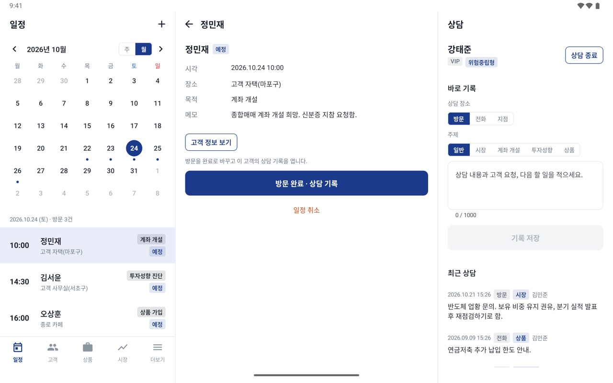
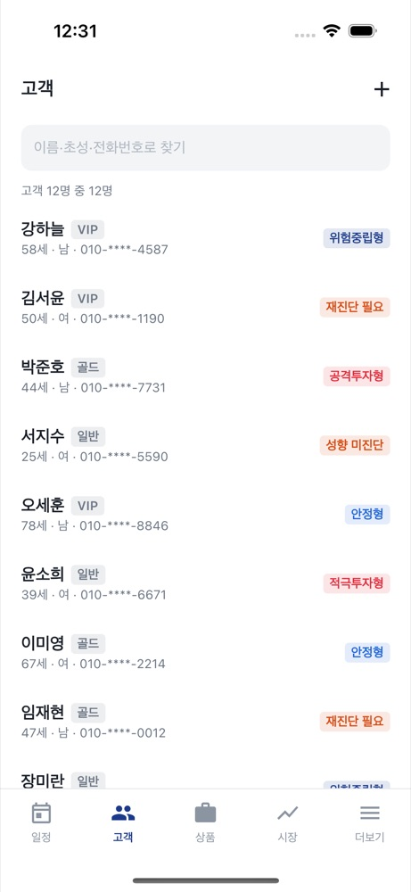
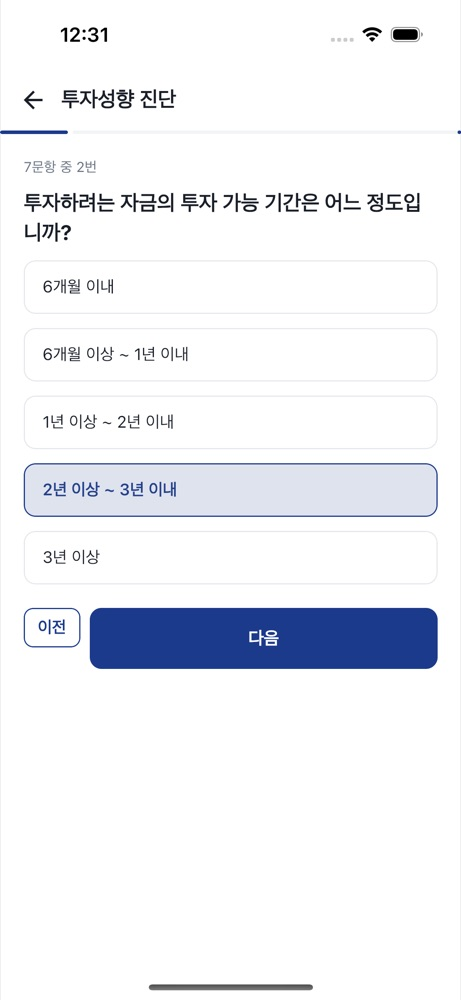
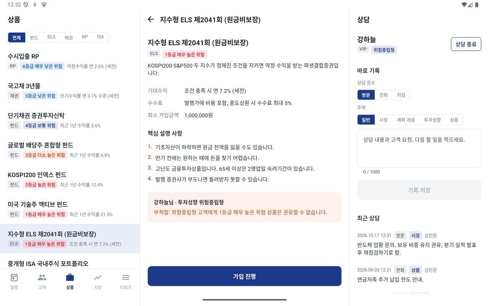
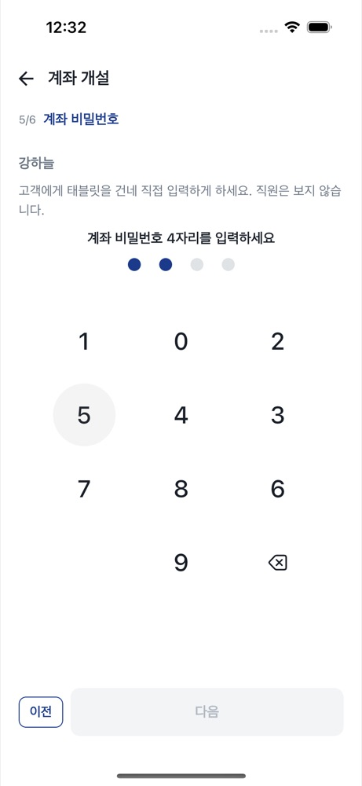
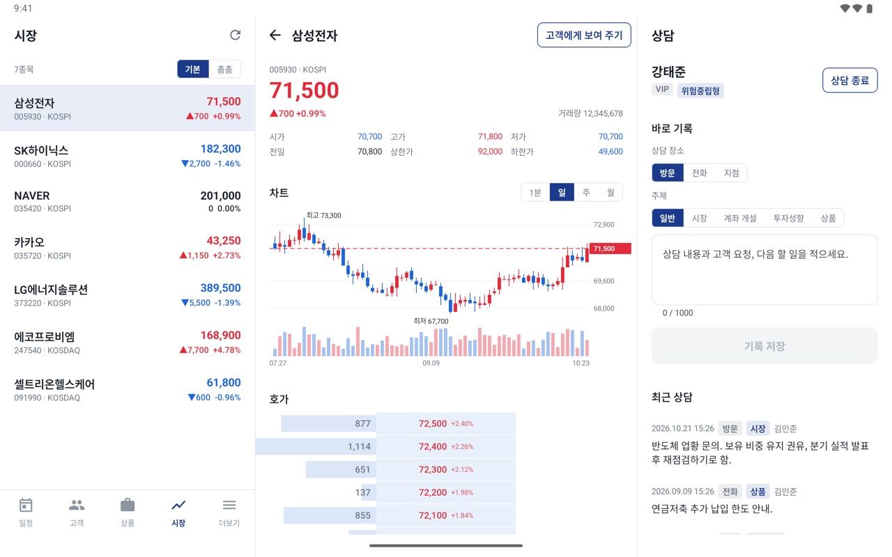
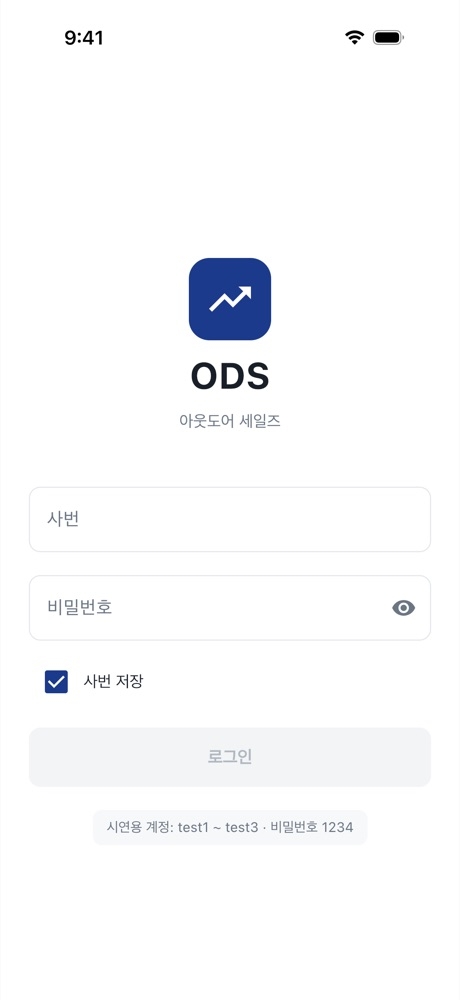

# ODS — 증권사 아웃도어 세일즈 앱

증권사 영업 직원이 태블릿을 들고 **지점 밖에서 고객을 만나** 방문 일정 → 상담 → 투자성향 진단 → 상품 가입·계좌 개설을 현장에서 마치는 앱입니다.
Kotlin Multiplatform 으로 Android·iOS 를 한 코드로 만들었고, 폰·태블릿 2칸·태블릿 가로 3칸 레이아웃을 창 폭에 따라 바꿉니다.

<p align="center">
  
</p>
<p align="center"><sub>태블릿 가로 3칸 — 왼쪽 고객 목록, 가운데 고객 상세, 오른쪽 상담 칸(상담 중인 고객을 따라가며 바로 기록)</sub></p>

| 항목 | 내용 |
|---|---|
| 플랫폼 | Android · iOS (Kotlin Multiplatform + Compose Multiplatform) |
| 구조 | Clean Architecture(data · domain · ui) + MVI(Action → ViewModel → `StateFlow<UiState>`, 일회성 Event) |
| 데이터 | 서버 없이 기기 안 시연용 데이터로 동작하는 **로컬 모드** (SQLDelight) |
| 검증 | 단위·ViewModel 시나리오 테스트(Android 101 · iOS 97) + Maestro 실화면 흐름 7개 × Android·iOS, 명령 하나(`verifyAll`) |
| 시연 계정 | `test1` ~ `test3` / `1234` — 처음 로그인하면 앱 잠금 비밀번호 6자리를 정합니다 |

---

## 화면 둘러보기

> 스크린샷의 고객·계좌·시세는 모두 시연용 예시 값입니다. 개인정보 가리기를 켠 상태(기본값)라 전화번호·생년월일·주소·계좌번호가 가려져 있습니다.

### 1. 오늘의 방문 일정

<p>
  
  &nbsp;
  
</p>

앱을 열면 먼저 보이는 탭입니다. 한 주 달력에서 날을 고르면 그날의 방문이 시각순으로 나오고, 방문이 있는 날에는 점이 찍힙니다.
일정을 등록할 때는 고객(이름·초성·전화번호 검색), 날짜, 30분 단위 시각, 장소, 목적을 받고 **지난 시각은 받지 않습니다.**
방문을 **완료**하면 그 고객과 상담 중으로 바뀌고, 방문 목적(계좌 개설·투자성향 진단·상품 가입)이 주제로 미리 골라진 상담 기록 화면이 열립니다.

### 2. 고객 — 검색 · 상세 · 상담 이력

<p>
  
  &nbsp;
  
</p>

- **검색**: 이름 일부, 한글 초성(`ㄱㅎㄴ`), 전화번호 숫자 일부로 찾습니다. 목록에서 투자성향이 없거나 1년이 지난 고객은 주황으로 `성향 미진단`·`재진단 필요` 를 보입니다.
- **상세**: 기본 정보, 투자성향, 보유 계좌, 가입 상품, 방문 예정, 상담 이력이 한 화면에 있고, 구역마다 그 구역의 업무(진단·개설·일정 추가·상담 기록)로 가는 버튼이 있습니다.
- **개인정보 가리기**: 기본으로 켜져 있어 고객 앞에서 태블릿을 펼쳐도 안전합니다. 제목줄의 눈 버튼으로 바로 전환합니다.
- **넓은 태블릿(1000dp 이상)**: 맨 위 스크린샷처럼 오른쪽 끝에 **상담 칸**이 생깁니다. 가운데에서 시세를 보여 주거나 상품을 설명하는 동안에도 상담 중인 고객과 메모가 남아 있습니다.

### 3. 투자성향 진단 — 고객 확인과 전자서명

<p>
  
  &nbsp;
  
</p>

금융투자협회 표준 투자자정보확인서를 줄인 **7문항**을 하나씩 묻고(나이 문항은 생년월일로 미리 고름), 점수 0~100 으로 **안정형 ~ 공격투자형 5단계**를 정합니다.
결과 화면에서 권유할 수 있는 상품 위험등급을 알려 주고, 65세 이상이면 고령투자자 보호 절차를 안내합니다.
**고객이 직접 응답했다는 확인과 전자서명**을 받아야 저장되고, 저장하면 고객의 성향·진단일이 바뀌며 상담 이력에 기록이 남습니다.
서명 그림은 기기에 남기지 않고 지문(SHA-256 해시)과 시각만 남깁니다.

### 4. 상품 설명 · 가입 — 적합성 원칙

<p>
  
  &nbsp;
  
</p>

상품마다 위험등급(1 매우 높은 위험 ~ 6 매우 낮은 위험), 기대수익, 수수료, **핵심 설명 사항**이 있습니다.
상세 아래에는 상담 중 고객에게 이 상품이 맞는지 바로 보입니다(위 왼쪽: 위험중립형 고객에게 1등급 ELS → 부적합).

가입은 **고객 → 적합성 → 핵심 설명 → 출금계좌·금액 → 서명** 다섯 단계입니다.

- 투자성향이 없거나 1년이 지났으면 **진단부터** 하게 막습니다(진단을 마치고 돌아오면 다시 판정).
- 성향보다 위험한 상품은 권유할 수 없으므로, **고객이 스스로 원한다는 확인**을 받아야 넘어갑니다(위 오른쪽).
- 핵심 설명은 항목마다 설명했다는 표시를 받아야 넘어갑니다.
- 고령투자자가 고난도·고위험 상품에 가입하면 **2일 숙려기간**이 붙습니다.
- 화면이 막은 조건도 유스케이스가 저장 직전에 **한 번 더 확인**합니다(적합성·금액·계좌·서명).

### 5. 계좌 개설 — 신분증 촬영 · 고객 직접 입력

<p>
  
  &nbsp;
  
</p>

**신분증 촬영 → 본인 확인 → 계좌 종류 → 약관 동의 → 계좌 비밀번호 → 서명** 여섯 단계입니다.

- **신분증**: 카메라로 찍고(Android 시스템 카메라 / iOS UIImagePickerController), 직원이 이름·주민번호 앞 6자리·뒷자리 첫 숫자를 옮겨 적으면 고객 정보와 대조한 뒤 진위를 확인합니다.
  사진은 확인에만 쓰고 **기기에 남기지 않습니다**(Android 는 임시 파일을 읽자마자 지움). 서버 없는 시연에서는 `시연용 신분증 사용` 으로 넘어갈 수 있습니다.
- **계좌 종류**: ISA 는 만 19세 이상·1인 1계좌, 연금저축 중복은 까닭과 함께 막습니다.
- **계좌 비밀번호**: 고객에게 태블릿을 건네 **고객이 직접** 넣습니다. 숫자 배열이 열 때마다 섞이고, 같은·연속·생년월일 숫자는 받지 않으며, 기기에 저장하지 않습니다.

### 6. 시장 — 고객에게 크게 보여 주기

<p>
  
  &nbsp;
  
</p>

관심종목 시세, 봉 차트(1분·일·주·월), 10단 호가를 봅니다. 상담 중에 `고객에게 보여 주기` 를 누르면 **종목·현재가·차트만 화면 전체에 크게** 띄우고
직원용 정보(호가·다른 고객·상담 칸)는 그리지 않습니다. 아래 단추로 관심종목을 넘기며 설명하고, 시연용 시세라는 안내를 함께 보입니다.
등락색은 국내 관례(상승 빨강·하락 파랑)를 따르고, 색만으로 알리지 않게 ▲▼ 와 부호를 함께 씁니다.

### 7. 직원 인증 · 단말 보안

<p>
  
  &nbsp;
  
</p>

밖에서 들고 다니는 단말이라 **잃어버리거나 고객 앞에 둔 채 자리를 비울 때**를 대비했습니다.

- 사번 로그인(5회 오류 시 5분 잠금, 비밀번호 저장 안 함) 뒤 직원별 **6자리 앱 잠금 비밀번호**(+생체 인증)
- **5분 무조작** 또는 **백그라운드에 1분 넘게** 있다 돌아오면 잠금. 잠겨도 보던 화면은 그대로 두고 풀면 이어 갑니다
- 잠금 비밀번호를 **5번 틀리면 기기 안 업무 데이터와 잠금 비밀번호를 모두 지우고 로그아웃**합니다(시간으로 풀리지 않게 해 주운 사람이 계속 시도할 수 없게).
  데이터를 잠근 키도 함께 버려, DB 파일에 지운 행의 조각이 남아도 풀 수 없습니다
- **기기 DB 의 개인정보 칸을 잠가 저장**합니다 — 고객 이름·생년월일·전화번호·주소, 상담 내용, 방문 장소·메모, 계좌번호.
  앱 잠금 비밀번호의 salt·해시와 기억한 사번도 잠가 둡니다(설정 파일만 빼내서는 6자리를 대입해 볼 수 없게).
  Android 는 Keystore 키로 감싼 데이터 키로 AES-256-GCM, iOS 는 Keychain(`ThisDeviceOnly`) 키로 AES-256-CBC + HMAC-SHA256 입니다.
  키는 백업·기기 이전에 따라가지 않고 DB 도 백업에서 빠집니다. 키와 DB 의 짝이 맞지 않으면 풀 수 없는 업무 데이터를 지우고 새로 시작합니다
- 앱 전환기 화면 가리기(Android·iOS), 배포용 Android 빌드의 화면 캡처 차단

---

## 업무 규칙 한눈에

규칙은 모두 `domain/util` 에 순수 함수로 두고 단위 테스트로 지킵니다.

| 규칙 | 내용 | 코드 |
|---|---|---|
| 투자성향 | 7문항 → 0~100 → 5단계, 유효기간 1년, 65세 이상 고령투자자 | `RiskAssessmentPolicy`, `hasValidRiskProfile` |
| 적합성 | 성향 없음·만료 → 진단부터, 성향보다 위험 → 고객 자발 확인 필요 | `suitabilityFor`, `RiskProfile.allows` |
| 숙려기간 | 고령투자자 × (고난도 또는 1·2등급) → 2일 | `SubscriptionPolicy` |
| 계좌 개설 | 신분증 대조, ISA 만 19세·1인 1계좌, 연금저축 중복 금지, 약한 비밀번호 금지 | `AccountOpeningPolicy`, `mismatchesWith` |
| 서명 | 점 10개 이상, 칸의 15% 이상 퍼져야 받음 | `SignaturePolicy` |
| 앱 잠금 | 6자리, 5분 무조작·백그라운드 1분, 5회 오류 시 데이터 삭제 | `AppLockPolicy`, `LockIfInactiveUseCase` |
| 고객 검색 | 이름·초성·전화번호 일부 | `matchesQuery` |

## 기술 스택 · 구조

| 영역 | 사용 |
|---|---|
| UI | Compose Multiplatform, Voyager(오른쪽 스택 하나를 폰·태블릿 레이아웃이 함께 씀) |
| DI · 저장 | Koin, SQLDelight(기기 DB, 개인정보 칸 암호화), multiplatform-settings, krypto(SHA-256) · Keystore · Keychain/CommonCrypto |
| 플랫폼 기능 | 생체 인증(BiometricPrompt · LAContext), 카메라(FileProvider · UIImagePickerController), 앱 전환기 가리기 |

```
composeApp/src/commonMain/kotlin/com/eunilsung/ods/
  data/    local(로컬 저장소 구현 · 시연용 데이터 · 업무 데이터 삭제) · mapper
  domain/  model · repository(인터페이스) · usecase · util(업무 규칙)
  ui/      main(폰·태블릿 레이아웃) · schedule · customer · risk · product · account · quote · consult · applock · uikit
  di/      Modules.kt — 저장소 구현을 갈라 끼우는 한 곳
```

- 화면은 ViewModel 만, ViewModel 은 유스케이스만 봅니다. 여러 저장소를 잇는 업무(가입·계좌 개설·진단 저장)는 유스케이스가 합니다.
- 업무를 마치면 상담 이력에 자동 기록이 남고, 기록한 직원은 로그인한 직원입니다.
- 한글은 하드코딩하지 않고 `composeResources/values`(영문)·`values-ko`(한글)로 나눴습니다.

### 서버 없이 도는 이유

서버 연동(Ktor 서버·WebSocket·서버 응답 반영·진짜 서버에 붙는 기능 테스트)은 함께 만든 Talk 프로젝트에서 보여 주고,
ODS 는 **증권 업무 규칙과 현장 UX** 에 집중했습니다. 설치만 하면 바로 전 과정을 따라가 볼 수 있습니다.
저장소는 모두 인터페이스 뒤에 있고 `Config.Server` · `di/Modules.kt` 한 곳에서 서버 구현으로 갈라 끼울 수 있게 해 두었습니다.

## 실행

```bash
./gradlew :composeApp:installDebug          # Android
open iosApp/iosApp.xcodeproj                # iOS (Xcode 에서 시뮬레이터를 고르고 실행)
```

JDK 17 과 `local.properties` 의 `sdk.dir` 이 필요합니다. 개발 규칙·구조는 [CLAUDE.md](CLAUDE.md), 디자인 방향은 [docs/design-proposal.html](docs/design-proposal.html) 에 있습니다.

## 검증 — 한 번에

```bash
./gradlew :composeApp:verifyAll --continue
```

Android Studio 에서는 실행 구성 **`검증 - 전체 (실화면 포함)`** 을 고르고 실행합니다(고칠 때마다는 `검증 - 빠르게 (JVM)`). 기기를 켜는 것까지 18분쯤 걸립니다.

1. 단위·ViewModel 시나리오 테스트(Android JVM) — 업무 규칙과 화면 상태·이벤트를 인메모리 DB 위에서 봅니다
2. 같은 테스트(iOS 시뮬레이터)
3. Android 앱 빌드 → 에뮬레이터에 설치 → Maestro 실화면 흐름 7개
4. iOS 앱 빌드 → 시뮬레이터에 설치 → 같은 흐름 7개

| 실화면 흐름 | 확인하는 것 |
|---|---|
| 로그인·시장 | 로그인, 시세 상세, 고객에게 보여 주기, 로그아웃 |
| 앱 잠금 | 지금 잠그기 → 풀기, 5번 틀리면 데이터 삭제 후 로그인 화면 |
| 고객 | 전화번호 검색, 상담 기록, 신규 고객 등록 |
| 방문 일정 | 다음 주 일정 등록, 방문 완료 → 상담 기록 |
| 투자성향 | 7문항, 고객 확인, 서명, 저장 후 상담 이력 |
| 상품 가입 | 적합성 → 핵심 설명 → 계좌·금액 → 서명 → 완료 |
| 계좌 개설 | 신분증 확인 → 계좌 종류 → 약관 → 고객 비밀번호 → 서명 → 새 계좌 |

**준비** — Maestro(`curl -fsSL https://get.maestro.mobile.dev | bash`), Xcode, 그리고 `local.properties` 에 이 PC 의 검증 기기를 적습니다(꺼져 있으면 켜서 씁니다).

```properties
e2e.androidAvd=<에뮬레이터 이름>
e2e.iosDevice=<시뮬레이터 UDID 또는 이름>
```

**결과** — `composeApp/build/test-results/`(JVM·iOS 테스트), `build/maestro/<android|ios>/report.xml` 과 스크린샷·로그.

**자동으로 확인하지 못하는 것** — 실제 카메라 촬영, 생체 인증, 배포 빌드의 화면 캡처 차단. 손으로 확인합니다.

## 아직 없는 것

서버 연동(원격 단말 잠금 포함), 신분증 OCR·사진 속 주민번호 가리기, 숙려기간 중 철회, 가입 내역 상세·해지, 앱 안 테마 고르기, 전용 글꼴.
